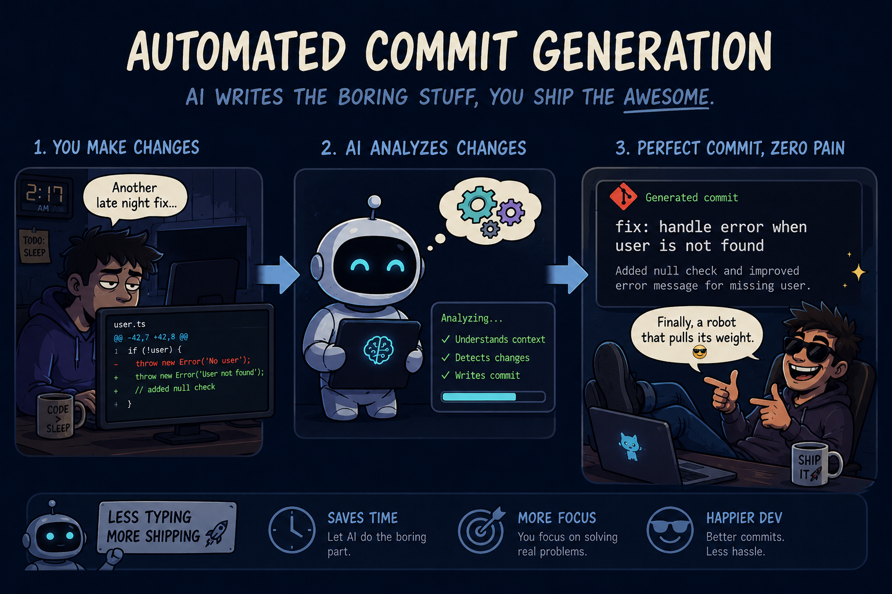

# git-commit-gen



Generate git commit messages automatically using an LLM.

## How it works

- The tool starts an LLM agent for the current branch
- The agent has four tools: `GetCurrentBranch`, `LoadDiff`, `UpdateFirstCommit`, and `VerifyFirstCommit`
- `LoadDiff` returns the diff between the current branch and the base branch (default: main)
- The agent generates a commit message based on the diff and your rules.md file
- `UpdateFirstCommit` applies the message to the first commit of the current branch
- `VerifyFirstCommit` confirms that the first commit contains the generated message
- With `-v` the commit message, backup ref, token usage, and API request count are printed to stdout as a table

## Installation

```bash
go install github.com/yvv4git/git-commit-gen@latest
```

Or build from source:

```bash
go install .
```

Or build to a specific path:

```bash
go build -o ~/go/bin/git-commit-gen .
```

After installation, create default config files:

```bash
git-commit-gen setup
```

This creates `config.toml` and `rules.md` in `~/.config/git_commit_gen/`.

## Usage

Run inside a git repository:

```bash
git-commit-gen gen
```

To print the generated message and backup ref:

```bash
git-commit-gen gen -v
```

The output is a table with the commit message, backup ref, token usage, and the number of LLM API requests:

```text
┌────────────────┬──────────────────────────────────────────────┐
│ Field          │ Value                                        │
├────────────────┼──────────────────────────────────────────────┤
│ Commit message │ TASK-17: add guard                           │
│                │                                              │
│                │ - protect input                              │
│ Backup         │ refs/git-commit-gen/backup/<timestamp>       │
│ Tokens         │ prompt: 1200, completion: 300, total: 1500   │
│ API requests   │ 6                                            │
└────────────────┴──────────────────────────────────────────────┘
```

The `Backup` row is omitted when no backup ref was created. Token usage is summed over all
successful LLM responses; `API requests` also counts failed attempts that were retried.

To use a specific LLM provider defined in the config:

```bash
git-commit-gen gen -p secondary
```

If `-p` is omitted, the first provider from the `[[llms]]` list is used.

### Provider check

To verify that a provider is reachable and the model responds without touching the repository:

```bash
git-commit-gen check -p secondary
```

The command sends a single prompt and prints the provider status and the model reply:

```text
Provider "secondary" is working.

Model reply:
I am a large language model.
```

If `-p` is omitted, the first provider from the `[[llms]]` list is used.

### Backup and rollback

Before rewriting the first commit, the tool creates a local backup ref
`refs/git-commit-gen/backup/<timestamp>`. The `Backup` row of the `-v` output shows it.
To undo the rewrite:

```bash
git reset --hard refs/git-commit-gen/backup/<timestamp>
```

## Configuration

Create a TOML config file (see config.example.toml):

- **generator.baseBranch** -- branch to diff against (default: main)
- **generator.rulesFile** -- path to rules.md with commit style rules
- **generator.maxDiffBytes** -- maximum diff size sent to the LLM (default: 262144)
- **generator.maxRulesBytes** -- maximum rules.md size (default: 32768)
- **generator.maxContextBytes** -- maximum accumulated agent context (default: 524288)
- **generator.maxAgentTurns** -- maximum LLM turns per run (default: 12)
- **generator.maxToolCallsPerTurn** -- maximum tool calls in one turn (default: 8)
- **llms.name** -- provider name to select with `-p`
- **llms.requestTimeout** -- per-attempt LLM request timeout (default: 90s)
- **llms.openai.api** -- OpenAI-compatible API URL (config.toml only)
- **llms.openai.token** -- API token
- **llms.openai.model** -- tool-calling model name (default: gpt-4o)
- **llms.openai.allowInsecureHttp** -- allow plaintext `http://` for a non-local API (default: false)
- **llms.proxy** -- optional proxy settings (http or socks5)
- **llms.retry.retries** -- number of retries after the first failed request (default: 3)
- **llms.retry.initInterval** -- initial backoff interval (default: 500ms)
- **llms.retry.maxInterval** -- maximum backoff interval (default: 10s)

### Limits

The generator stops before sending a request that exceeds a limit:

- a diff larger than `maxDiffBytes` fails with `diff too large`;
- rules larger than `maxRulesBytes` fail with `rules too large`;
- accumulated messages larger than `maxContextBytes` fail with `context budget exceeded`;
- more than `maxAgentTurns` turns fail with `agent turns exceeded`;
- more than `maxToolCallsPerTurn` tool calls in one turn fail with `too many tool calls`.

The context budget approximates request size and cost: it covers the system prompt, rules, diff,
tool results, and assistant messages. The diff is loaded at most once per run.

Retries use exponential backoff. HTTP `4xx` responses are not retried except `429 Too Many Requests`.
For `429`, `Retry-After` is respected and capped by `maxInterval`. HTTP `5xx`, network errors,
and per-attempt request timeouts are retried. Ctrl-C cancels the current attempt and stops retries.

If the `[llms.retry]` section is omitted, defaults are used: `retries = 3`, `initInterval = "500ms"`,
`maxInterval = "10s"`.

## Data egress and trust boundaries

`git-commit-gen` sends data only to the LLM endpoint configured in `config.toml`.
A request contains the system prompt, the contents of the rules file, the current branch name,
the diff between the merge base of the base branch and the current branch, and accumulated tool results.

Before a diff is added to the agent context, common secrets are redacted: PEM private keys,
OpenAI/OpenRouter keys, GitHub tokens, AWS access keys, JWTs, bearer tokens, URL credentials,
and `token`/`secret`/`password`/`api_key` assignments. Redaction is best-effort and cannot guarantee
that every secret is removed. Do not run the tool on a branch with production credentials that must
never leave the machine.

The API URL must use `https://`. Plain `http://` is allowed only for `localhost` and loopback
addresses (`127.0.0.1`, `::1`), or for a non-local endpoint when `llms.openai.allowInsecureHttp = true`
is explicitly set. If a proxy is enabled, all LLM traffic goes through that proxy.

To keep the diff, rules, and branch name local, configure a local OpenAI-compatible server, for example
`api = "http://localhost:11434/v1"`. `config.toml` is read from the application config directory,
while `.env` and `rules.md` may come from the current working directory; review them before running
the tool in an untrusted repository.

Multiple providers can be defined by repeating the `[[llms]]` block with a unique `name`.

The model must support tool calling. For the OpenRouter free tier, use `model = "openrouter/free"`:
the router selects an available free model automatically. Some free models are restricted to
registered agent apps and return `403`, so a specific free model may stop working.

## Environment overrides

`config.toml` is read from the application config directory, `~/.config/git_commit_gen/config.toml` by default.
After that, the tool reads `.env` from the current working directory.
Values from `.env` override `config.toml`; process environment variables are not used.

Supported `.env` keys:

- `GIT_GEN_BASE_BRANCH`
- `GIT_GEN_PROXY_ENABLE`, `GIT_GEN_PROXY_TYPE`, `GIT_GEN_PROXY_ADDR`, `GIT_GEN_PROXY_LOGIN`, `GIT_GEN_PROXY_PASSW`
- `GIT_GEN_LLM_RETRY_RETRIES`, `GIT_GEN_LLM_RETRY_INIT_INTERVAL`, `GIT_GEN_LLM_RETRY_MAX_INTERVAL`
- `GIT_GEN_OPENAI_TOKEN`, `GIT_GEN_OPENAI_MODEL`

`GIT_GEN_OPENAI_API` is not read from `.env`; set the API URL in `config.toml`.
Provider overrides apply to every `[[llms]]` entry.
Because `.env` comes from the working directory, do not run the tool in an untrusted repository with an unexpected `.env`.

## Secrets

`config.toml` contains the API token and proxy password.
The `setup` command creates it with `0600` permissions and the config directory with `0700`.
Keep `.env` out of version control and rotate the token if it was exposed.

## TODO

- [ ] Add automatic OpenRouter token rotation in the future.

## Rules file

The `rules.md` file contains guidelines for commit message format.
The LLM will follow these rules when generating messages.
See `rules.example.md` for an example.

The rules file is resolved in this order:

1. The `generator.rulesFile` path, relative to the current working directory or absolute.
2. `~/.config/git_commit_gen/rules.md`.

If neither file exists, the command fails before it creates an LLM client or sends a request.
The `config.toml` file is never read as the rules file.

<p align="center">
  <a href="https://tonviewer.com/UQCcbp-mue-7HTjDNQ_ZrKtg-tUxIFu817APmItjXasiBGP3">
    
  </a>
</p>

<p align="center">
  If this tool helps you, consider buying me a coffee! ☕
</p>
