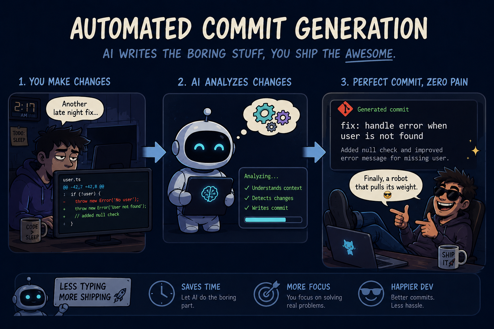

# git-commit-gen



Generate git commit messages automatically using an LLM.

## How it works

- The tool starts an LLM agent for the current branch
- The agent has four tools: `GetCurrentBranch`, `LoadDiff`, `UpdateFirstCommit`, and `VerifyFirstCommit`
- `LoadDiff` returns the diff between the current branch and the base branch (default: main)
- The agent generates a commit message based on the diff and your rules.md file
- `UpdateFirstCommit` applies the message to the first commit of the current branch
- `VerifyFirstCommit` confirms that the first commit contains the generated message
- With `-v` the generated commit message is printed to stdout

## Installation

```bash
go install github.com/yvv4git/git-commit-gen@latest
```

Or build from source:

```bash
go install .
```

Or build to a specific path:

```bash
go build -o ~/go/bin/git-commit-gen .
```

After installation, create default config files:

```bash
git-commit-gen setup
```

This creates `config.toml` and `rules.md` in `~/.config/git_commit_gen/`.

## Usage

Run inside a git repository:

```bash
git-commit-gen gen
```

To print the generated message:

```bash
git-commit-gen gen -v
```

To use a specific LLM provider defined in the config:

```bash
git-commit-gen gen -p secondary
```

If `-p` is omitted, the first provider from the `[[llms]]` list is used.

## Configuration

Create a TOML config file (see config.example.toml):

- **generator.baseBranch** -- branch to diff against (default: main)
- **generator.rulesFile** -- path to rules.md with commit style rules
- **llms.name** -- provider name to select with `-p`
- **llms.openai.api** -- OpenAI-compatible API URL
- **llms.openai.token** -- API token
- **llms.openai.model** -- tool-calling model name (default: gpt-4o)
- **llms.proxy** -- optional proxy settings (http or socks5)
- **llms.retry.retries** -- number of retries after the first failed request (default: 3)
- **llms.retry.initInterval** -- initial backoff interval (default: 500ms)
- **llms.retry.maxInterval** -- maximum backoff interval (default: 10s)

Multiple providers can be defined by repeating the `[[llms]]` block with a unique `name`.

The model must support tool calling. For the OpenRouter free tier, use `model = "openrouter/free"`:
the router selects an available free model automatically. Some free models are restricted to
registered agent apps and return `403`, so a specific free model may stop working.

Environment variables (OPENAI_TOKEN, OPENAI_API, OPENAI_MODEL, PROXY_TYPE, etc.) can also be used.

## Rules file

The rules.md file contains guidelines for commit message format. The LLM will follow these rules when generating messages. See rules.example.md for an example.

<p align="center">
  <a href="https://tonviewer.com/UQCcbp-mue-7HTjDNQ_ZrKtg-tUxIFu817APmItjXasiBGP3">
    
  </a>
</p>

<p align="center">
  If this tool helps you, consider buying me a coffee! ☕
</p>
